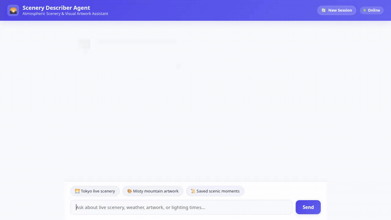

# 🌅 Scenery Describer Agent

> An agentic AI poet and fine-art visual orchestrator that crafts evocative landscape descriptions and generates stunning visual artwork grounded in real-time location weather, solar lighting, air quality, and personal memory.



---

## 🌟 Overview

**Scenery Describer Agent** is an agentic application built with Google's **Agent Development Kit (ADK)** and `agents-cli`. It acts as a poetic environmental assistant and fine-art visualizer, helping users discover, experience, and preserve scenic moments around the globe.

Given any location or prompt, the agent gathers real-time atmospheric metrics (live temperature, weather conditions, solar sunrise/sunset/golden hour windows, and air quality index) and produces:
1. **Evocative, poetic scenery descriptions** tailored to the exact environment and time of day.
2. **AI-generated fine-art visual artwork** capturing the precise lighting and mood.
3. **Structured A2UI Cards** displaying the description and artwork inline in the chat interface.
4. **Firestore cataloging** for saving and searching favorite scenic moments.

---

## 🏗️ Architecture & Wired-up Features

Every feature listed below is fully implemented and wired up in `app/` and `agents-cli-manifest.yaml`:

| Feature / Layer | Implementation Details | Wired-up Technologies |
|---|---|---|
| 🤖 **Core Agent & Model** | ReAct reasoning loop powered by Gemini 2.5 Flash | `google.adk.agents.Agent`, `Gemini(gemini-2.5-flash)` |
| 🧠 **Cross-Session Memory** | Preloads and persists user preferences (aesthetic style, favorite spots) across sessions | Vertex AI Memory Bank (`PreloadMemoryTool`, `add_session_to_memory` callback) |
| 🗄️ **Structured Catalog** | Persists "Saved Scenic Moments" (title, location, weather, lighting, style tags) | Google Cloud Firestore (`scenic_moments` collection) |
| 🖼️ **Media Storage** | Uploads generated artwork and videos to a public bucket for instant web rendering | Google Cloud Storage (`scenery-describer-images-31b0418c`) |
| 🎨 **AI Image Generation** | Generates fine-art visual artwork matching environmental descriptions | Vertex AI `gemini-3.1-flash-lite-image` |
| 🎬 **AI Video Generation** | Generates short scenic videos for motion requests | Vertex AI `gemini-omni-flash-preview` |
| 🪟 **Agent-First UI (A2UI)** | Renders rich UI cards (Text + Image components) dynamically in the frontend | ADK A2UI (`a2ui_callback`, `A2uiSchemaManager`) |
| 🧪 **Code Execution Sandbox** | Safely executes Python code for lighting window & time calculations | `AgentEngineSandboxCodeExecutor` |
| 🌤️ **Live Weather & Solar Tools** | Fetches live weather, solar sunrise/sunset, and time zone offsets | Open-Meteo API & Python `zoneinfo` |
| 🗺️ **Sub-Agents** | Specialized sub-agents for Air Quality, Google Geo (Maps/Places), and Media Generation | Multi-agent ADK architecture (`air_quality_agent`, `google_geo_agent`, `gogle_media_generator_agent`) |

---

## 📋 Tool & Service Breakdown

### 1. Environmental & Geo Tools
- **Live Weather (`get_live_weather`)**: Fetches temperature (°C/°F), atmospheric condition (WMO weather code), day/night period, and wind speed.
- **Solar Schedule (`get_sun_times`)**: Calculates exact sunrise, sunset, morning/evening golden hour, and evening blue hour lighting windows.
- **Local Time & Differences (`get_current_time`, `calculate_time_difference`)**: Computes exact local times and timezone differences across global locations.
- **Air Quality Sub-Agent (`air_quality_agent`)**: Fetches US AQI, PM2.5/PM10 particulate levels, UV Index, and atmospheric clarity.
- **Google Geo Sub-Agent (`google_geo_agent`)**: Geocodes street addresses and searches nearby places (parks, landmarks) via Google Maps & Google Places API.

### 2. Media Generation & Storage
- **Image Generation (`generate_scenery_image`)**: Generates custom fine-art artwork using `gemini-3.1-flash-lite-image`. Saves an ADK artifact and uploads image bytes directly to Google Cloud Storage for public URL serving.
- **Video Generation (`generate_scenery_video`)**: Generates short scenic videos using `gemini-omni-flash-preview` uploaded to Google Cloud Storage.

### 3. Memory & Firestore Journaling
- **Vertex AI Memory Bank**: Captures user style preferences (e.g. "cozy", "cinematic", "dramatic") and favorite locations automatically.
- **Firestore Scenic Journal (`save_scenic_moment`, `list_scenic_moments`, `search_scenic_moments_by_location`)**: Allows users to bookmark, view, and search saved atmospheric moments in Google Cloud Firestore.

---

## 📌 Implementation Status (Planned vs. Built)

### Implemented
- ✅ Live weather, timezone math, and solar timing (sunrise, sunset, golden/blue hour)
- ✅ Fine-art AI image generation & Cloud Storage hosting
- ✅ A2UI card generation with inline image and text components
- ✅ Firestore moment saving, searching, and listing
- ✅ Vertex AI Memory Bank session persistence
- ✅ Air quality and Google Maps/Places sub-agent integration
- ✅ Python code execution sandbox

### Planned, Not Yet Implemented
- ⏳ *Real-time astronomical lunar position tracking* (mentioned in initial brief, planned for future update)
- ⏳ *Automated solar window math inside code sandbox* (currently handled via deterministic Open-Meteo solar forecast API)

---

## 🛠️ Local Development & Setup

Follow these steps to run the agent and frontend locally on your machine.

### Prerequisites
- Python 3.10+
- `uv` package manager (`pip install uv` or follow [uv installation](https://docs.astral.sh/uv/))
- Authenticated Google Cloud credentials (`gcloud auth application-default login`)

### 1. Install Dependencies
```bash
# Install dependencies with agents-cli or uv
agents-cli install
```

### 2. Configure Environment Variables
Copy `.env.example` to `.env` and configure your settings:
```bash
cp .env.example .env
```
Ensure your GCP Project ID and optional API keys (e.g. `GOOGLE_MAPS_API_KEY`) are set.

### 3. (Optional) Seed Firestore Catalog
To populate initial sample scenic moments in Firestore:
```bash
python seed_firestore.py
```

### 4. Run the Local Development Servers

#### Option A: Run via ADK Playground
```bash
agents-cli playground
```

#### Option B: Run the FastAPI Proxy & Custom Web Frontend
In terminal 1 (Agent backend):
```bash
uv run uvicorn app.fast_api_app:app --port 8000 --reload
```

In terminal 2 (Web Frontend proxy):
```bash
python frontend/main.py
```
Then open your browser to `localhost:8080` (or the port indicated in terminal output).

---

## 🧪 Testing & Evaluation

Run unit and integration tests:
```bash
uv run pytest tests/unit tests/integration
```

Run agent evaluation with `agents-cli`:
```bash
agents-cli eval generate --dataset tests/eval/datasets/scenery_eval_dataset.json --output artifacts/traces
agents-cli eval grade --metrics general_quality --traces artifacts/traces
```

---

## 📄 License

This project is created for demonstration purposes as part of the **Build with Gemini** workshop.
